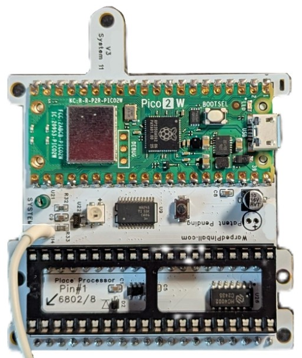
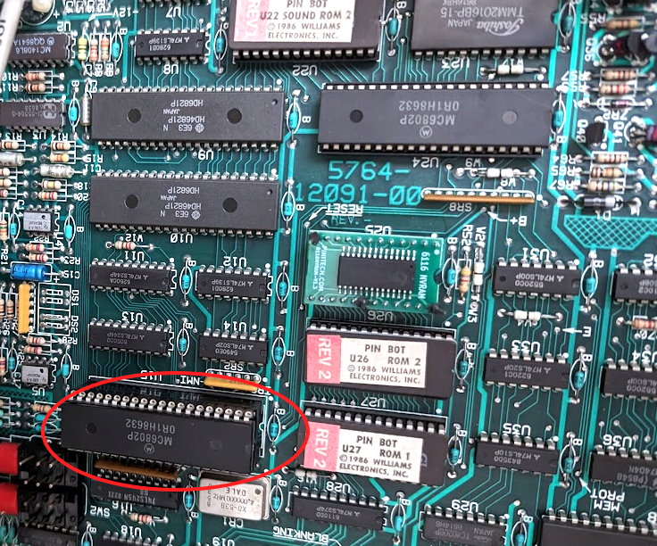
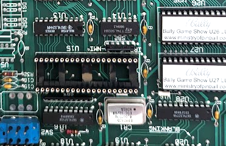
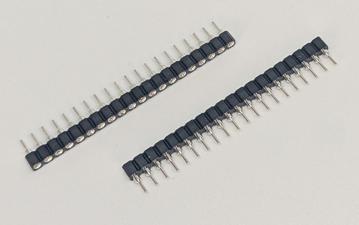
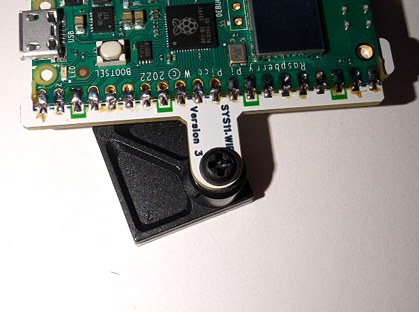
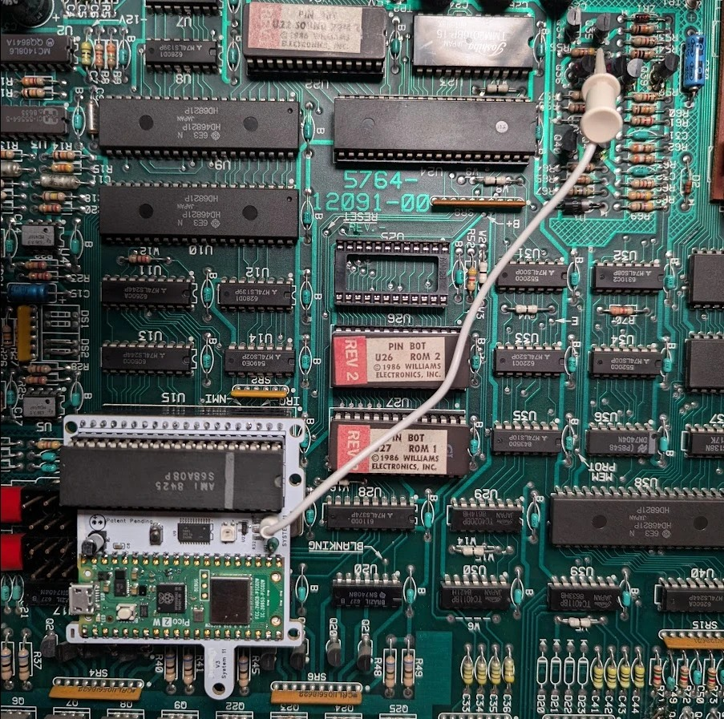
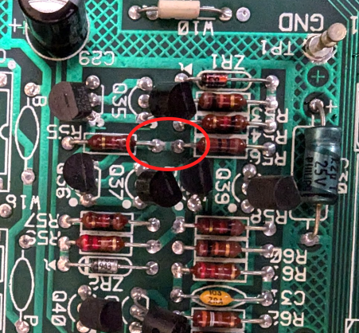

  <h1 style="margin: 0;">Vector System 11 WiFi Module Quick Start (v3)</h1>
  <button onclick="window.print()" style="white-space: nowrap;">
    🖨️ Print This Guide
  </button>

This is the quick start guide. If you have never installed a WiFi board from Warped Pinball, we encourage you to read the [full manual](manual.md) first. You can also check out installation videos at [WarpedPinball.com](https://WarpedPinball.com/#resources).

**Have the original Warped Pinball System 11 board?** See the [original board manual](manual_OG.md).

## Disclaimer

Removing classic game chips carries risk. Damage is possible and is not the responsibility of Warped Pinball. If you are unfamiliar with reseating chips, ask someone experienced to assist.

## Interface button and LEDs

|  | <strong>Status LED:</strong> <svg width="18" height="18" viewBox="0 0 18 18" style="vertical-align:middle"><g stroke="#f5d90a" stroke-width="1.6" stroke-linecap="round"><line x1="13.5" y1="9.0" x2="17.0" y2="9.0"/><line x1="9.0" y1="13.5" x2="9.0" y2="17.0"/><line x1="4.5" y1="9.0" x2="1.0" y2="9.0"/><line x1="9.0" y1="4.5" x2="9.0" y2="1.0"/></g><circle cx="9" cy="9" r="3.2" fill="#f5d90a"/></svg><svg width="18" height="18" viewBox="0 0 18 18" style="vertical-align:middle"><g stroke="#f5d90a" stroke-width="1.6" stroke-linecap="round"><line x1="13.5" y1="9.0" x2="17.0" y2="9.0"/><line x1="12.2" y1="12.2" x2="14.7" y2="14.7"/><line x1="9.0" y1="13.5" x2="9.0" y2="17.0"/><line x1="5.8" y1="12.2" x2="3.3" y2="14.7"/><line x1="4.5" y1="9.0" x2="1.0" y2="9.0"/><line x1="5.8" y1="5.8" x2="3.3" y2="3.3"/><line x1="9.0" y1="4.5" x2="9.0" y2="1.0"/><line x1="12.2" y1="5.8" x2="14.7" y2="3.3"/></g><circle cx="9" cy="9" r="3.2" fill="#f5d90a"/></svg> &nbsp;Trying to join WiFi <svg width="18" height="18" viewBox="0 0 18 18" style="vertical-align:middle"><g stroke="#2fae4a" stroke-width="1.6" stroke-linecap="round"><line x1="13.5" y1="9.0" x2="17.0" y2="9.0"/><line x1="9.0" y1="13.5" x2="9.0" y2="17.0"/><line x1="4.5" y1="9.0" x2="1.0" y2="9.0"/><line x1="9.0" y1="4.5" x2="9.0" y2="1.0"/></g><circle cx="9" cy="9" r="3.2" fill="#2fae4a"/></svg><svg width="18" height="18" viewBox="0 0 18 18" style="vertical-align:middle"><g stroke="#2fae4a" stroke-width="1.6" stroke-linecap="round"><line x1="13.5" y1="9.0" x2="17.0" y2="9.0"/><line x1="12.2" y1="12.2" x2="14.7" y2="14.7"/><line x1="9.0" y1="13.5" x2="9.0" y2="17.0"/><line x1="5.8" y1="12.2" x2="3.3" y2="14.7"/><line x1="4.5" y1="9.0" x2="1.0" y2="9.0"/><line x1="5.8" y1="5.8" x2="3.3" y2="3.3"/><line x1="9.0" y1="4.5" x2="9.0" y2="1.0"/><line x1="12.2" y1="5.8" x2="14.7" y2="3.3"/></g><circle cx="9" cy="9" r="3.2" fill="#2fae4a"/></svg> &nbsp;WiFi joined, all OK <svg width="18" height="18" viewBox="0 0 18 18" style="vertical-align:middle"><g stroke="#6a2c91" stroke-width="1.6" stroke-linecap="round"><line x1="13.5" y1="9.0" x2="17.0" y2="9.0"/><line x1="9.0" y1="13.5" x2="9.0" y2="17.0"/><line x1="4.5" y1="9.0" x2="1.0" y2="9.0"/><line x1="9.0" y1="4.5" x2="9.0" y2="1.0"/></g><circle cx="9" cy="9" r="3.2" fill="#6a2c91"/></svg><svg width="18" height="18" viewBox="0 0 18 18" style="vertical-align:middle"><g stroke="#6a2c91" stroke-width="1.6" stroke-linecap="round"><line x1="13.5" y1="9.0" x2="17.0" y2="9.0"/><line x1="12.2" y1="12.2" x2="14.7" y2="14.7"/><line x1="9.0" y1="13.5" x2="9.0" y2="17.0"/><line x1="5.8" y1="12.2" x2="3.3" y2="14.7"/><line x1="4.5" y1="9.0" x2="1.0" y2="9.0"/><line x1="5.8" y1="5.8" x2="3.3" y2="3.3"/><line x1="9.0" y1="4.5" x2="9.0" y2="1.0"/><line x1="12.2" y1="5.8" x2="14.7" y2="3.3"/></g><circle cx="9" cy="9" r="3.2" fill="#6a2c91"/></svg> &nbsp;AP mode: join with your phone  <svg width="18" height="18" viewBox="0 0 18 18" style="vertical-align:middle"><circle cx="9" cy="9" r="6.5" fill="#d7262b" stroke="#00000033" stroke-width="1"/></svg><svg width="18" height="18" viewBox="0 0 18 18" style="vertical-align:middle"><circle cx="9" cy="9" r="6.5" fill="#f5d90a" stroke="#00000033" stroke-width="1"/></svg> &nbsp;Hardware installation issue <svg width="18" height="18" viewBox="0 0 18 18" style="vertical-align:middle"><circle cx="9" cy="9" r="6.5" fill="#283a8f" stroke="#00000033" stroke-width="1"/></svg><svg width="18" height="18" viewBox="0 0 18 18" style="vertical-align:middle"><circle cx="9" cy="9" r="6.5" fill="#f5d90a" stroke="#00000033" stroke-width="1"/></svg> &nbsp;WiFi password wrong <svg width="18" height="18" viewBox="0 0 18 18" style="vertical-align:middle"><circle cx="9" cy="9" r="6.5" fill="#283a8f" stroke="#00000033" stroke-width="1"/></svg><svg width="18" height="18" viewBox="0 0 18 18" style="vertical-align:middle"><circle cx="9" cy="9" r="6.5" fill="#6a2c91" stroke="#00000033" stroke-width="1"/></svg> &nbsp;WiFi network not found  <strong>WiFi Button:</strong> hold during power-up and release when the LED flashes to enter AP (setup) mode.  <em>Find more codes in the <a href="../manual/#led-codes">full manual</a>.</em> |
| --- | --- |

## Hardware installation

1. **Power off your game.** Your Vector board from Warped Pinball installs in the socket where your game's main processor is now. Carefully remove the processor (6802/6808) and place it into the 40-pin socket on the Vector WiFi board. Pay attention to pin 1 and inspect for bent pins. Note the position of the main processor in your game (Figure 1).

    

2. Place two individual pin strips into each side of the socket on your main board. Push on the top of each pin firmly with your thumb so they are fully seated in the old processor socket (Figure 2).

    |  |  |
    | --- | --- |

3. Put the standoff on the board with the provided screw (Figure 3). **Do not remove the backing from the adhesive pad**; leave it on. Rotate the standoff so it sits mostly underneath the Warped Pinball board. It rests on the resistors and gives some padding.

    

4. Line up the pins on the back of Vector with the pin strips and gently press it in place (Figure 4). The processor should face the same way it did on the original board. This should not take too much force.

    

## Check the reset circuit

|  | Inspect the reset circuit area for modifications; a modified board can lead to unexpected results. Clip the white wire at the junction of **R55** and **R56** (circled in the photo). |
| --- | --- |

## Online setup

When installation is done, power on the game and use a phone to connect to the **Warped Pinball** WiFi network. There you can complete the setup of your game and get it connected to your WiFi. Select your game and ROM version (not listed? pick **GenericSystem11** and message us). Power-cycle the game when setup is complete, then connect with other linked Warped Pinball products or type the IP address shown on the display into any web browser. The **GenericSystem11** profile does not show the IP address on the display; find it in your router's device list instead.

**Tip:** set game adjustments **18**, **19**, **20** and **21** to zero so the game does not award credits each time a player enters initials.

## Supported games

*Williams & Bally System 9, 11, 11A, 11B and 11C*

Bad Cats · Banzai Run · Big Guns · Black Knight 2000 · Bugs Bunny's Birthday Ball · Cyclone · Diner · Dr. Dude · Earthshaker · Elvira and the Party Monsters · F-14 Tomcat · Fire! · Game Show · Grand Lizard · High Speed · Jokerz! · Millionaire · Mousin' Around · Pin•Bot · Police Force · Pool Sharks · Radical! · Riverboat Gambler · Road Kings · Rollergames · Space Station · Swords of Fury · Taxi · Transporter the Rescue · Whirlwind · Comet\* · Sorcerer\* · Space Shuttle\*

\* System 9 games: see the [System 9 manual](../system9/manual.md). ROM version not listed? Pick **GenericSystem11**.
